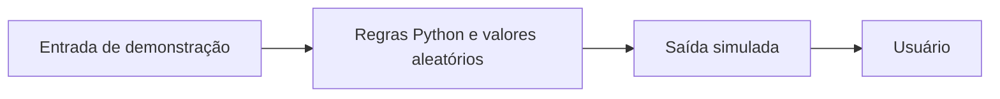

 |  | 

# Sentinela Soberano 2037 — Demonstrações Python

## Visão geral

O README apresenta uma iniciativa de longo prazo sobre soberania digital brasileira. O código efetivamente preenchido, porém, é uma pequena demonstração em Python: um gerador de estimativas aleatórias de risco condicionado por uma verificação de soberania simulada e um exemplo que codifica texto em Base64, rotulado como proteção. Não há evidência no conteúdo auditado de um sistema operacional de vigilância, IA, blockchain ou proteção de infraestrutura crítica.

## Objetivo e valor

**Problema/escopo:** Demonstrações em Python de estimativa aleatória de ameaças e codificação Base64, apresentadas sob o tema de soberania digital brasileira.

**Valor verificável hoje:** o repositório torna explícitos seus artefatos, interfaces e limitações para que mantenedores e contribuidores possam avaliar o que existe sem confundir demonstração, proposta e produção.

## Arquitetura e tecnologias

Não documentada. A árvore contém `src/core/forecaster_2037.py` e `src/security/sovereignty_shield.py`, cada qual com classe e bloco executável `__main__`, além de `tests/stress_test.py`; não há documentação de componentes, fluxos ou integração. Um segundo conjunto de diretórios aninhado em `SENTINELA-SOBERANO-2037/` contém arquivos vazios, inclusive um workflow vazio.

- Python é a única linguagem informada pelo endpoint público de linguagens do GitHub (6.045 bytes).
- Os dois módulos Python preenchidos usam apenas módulos da biblioteca padrão visíveis nos imports (`random`, `time`, `datetime`, `hashlib`, `base64`). Não foi encontrado manifesto de dependências ou configuração de empacotamento.
- Árvore contém módulos e stubs vazios sob diretórios de AI, blockchain, governança, satélite e scripts; os arquivos correspondentes aparecem com tamanho zero.

## Início rápido

Os comandos abaixo refletem instruções, manifestos ou pontos de entrada presentes no repositório. Dependências externas, segredos e serviços estão indicados quando aplicável; a presença de um comando não equivale a uma execução validada.

1. Não há instruções de instalação ou quickstart no README examinado, nem manifesto de dependências (por exemplo, `requirements.txt`, `pyproject.toml` ou `setup.py`) na árvore pública consultada.
2. O bloco `__main__` de `src/core/forecaster_2037.py` torna `python3 src/core/forecaster_2037.py` um comando de demonstração inferível a partir da interface existente; não é um comando documentado no README e a execução não foi testada na revisão estática do repositório.
3. O bloco `__main__` de `src/security/sovereignty_shield.py` oferece igualmente a demonstração `python3 src/security/sovereignty_shield.py`; execução não testada na revisão estática do repositório.

## Exemplo de uso

Exemplo possível a partir da interface real: executar `python3 src/core/forecaster_2037.py` para chamar `Forecaster2037.sovereign_check()` e, em seguida, `predict_threats()`. O código define riscos-base fixos e aplica variação aleatória; a checagem apenas simula a validação, define `is_sovereign = True` e retorna `True`. Não representa previsão validada nem verificação de infraestrutura real.

## Estado e limitações

**Maturidade indicada:** Demonstração.

- `sovereign_check()` descreve explicitamente uma checagem simulada: espera um segundo e marca o ambiente como soberano sem consultar IP, hardware ou certificados.
- `encrypt_critical_data()` apenas aplica Base64 e inclui um prefixo/trecho derivado de chave; não implementa AES nem criptografia resistente a computação quântica, apesar do rótulo `QUANTUM-RESISTANT-AES-256`.
- `tests/stress_test.py` descreve um ataque, mas seu loop contém apenas `pass`; as 1.000 tentativas não testam quebra de criptografia, e a taxa de sucesso impressa é texto fixo. Não interpretar o nome como evidência de teste de segurança real.
- O código de previsão usa valores de risco definidos manualmente e `random.uniform`; não há modelo de IA, dados de treinamento ou fonte observável para previsões.

## Contribuição

Leia [CONTRIBUTING.md](CONTRIBUTING.md) antes de abrir uma issue ou pull request. Para reportes de segurança, siga a orientação específica do repositório, se houver.

## Licença

Este repositório está licenciado sob **MIT**; consulte [LICENSE](LICENSE).

## Patrocínio e apoio

O desenvolvimento aberto exige tempo para manutenção, documentação, testes, revisão de contribuições e resposta a issues. Se este projeto for útil, considere apoiar a continuidade pelo [GitHub Sponsors](https://github.com/sponsors/felipetjmg1-bit). O apoio não representa promessa de funcionalidades, prazo de entrega ou suporte comercial.

